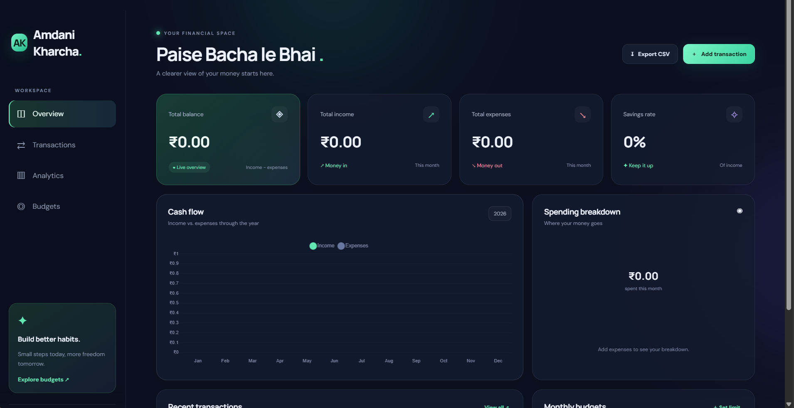

# 💰 Amdani Kharcha

### *Paise Bacha le Bhai.*

A premium, animated full-stack expense tracking dashboard. Track income and expenses, set category budgets, and understand your spending through live charts.

**🔗 Live Demo:** https://YOUR-APP-NAME.onrender.com
**📂 Source Code:** https://github.com/YOUR-USERNAME/expense-tracker-pro

> The free hosting plan sleeps after inactivity, so the first load may take 30–50 seconds.

---

## 📸 Screenshots

| Dashboard | Transactions |
|---|---|
|  |  |

---

## 🎯 Problem Statement

Most people do not know where their money goes each month. Spreadsheets are tedious and many apps are cluttered. Amdani Kharcha gives a simple, fast and good-looking way to record every transaction and see the full picture instantly.

## ✨ Features

- **Monthly summary:** balance, income, expenses and savings rate
- **Full transaction management:** add, edit, delete, search and filter
- **Visual analytics:** monthly income-vs-expense chart and category doughnut chart
- **Category budgets:** progress bars and overspending warnings
- **CSV export** of your data
- **Responsive dark UI** with smooth animations and reduced-motion support
- **Secure REST API** with server-side validation and consistent error responses

## 🛠️ Tech Stack

| Layer | Technology |
|---|---|
| Frontend | HTML, CSS, Vanilla JavaScript, Chart.js |
| Backend | Node.js, Express |
| Database | MongoDB, Mongoose |
| Testing | Node test runner, Supertest |
| Hosting | Render (app), MongoDB Atlas (database) |

## 🏗️ Architecture

```text
Browser (HTML/CSS/JS + Chart.js)
        │  fetch() JSON
        ▼
Express Server (REST API + static files)
        │  Mongoose
        ▼
MongoDB Atlas
```

The server serves both the frontend and the API from the same origin, so no separate frontend server is needed.

## 🚀 Run Locally

**Requirements:** Node.js 18+, npm, and MongoDB (local or Atlas).

```bash
# 1. Clone the repository
git clone https://github.com/YOUR-USERNAME/expense-tracker-pro.git
cd expense-tracker-pro

# 2. Install dependencies
npm install

# 3. Create the environment file
cp .env.example .env          # Windows PowerShell: Copy-Item .env.example .env

# 4. (Optional) Load demo data
npm run seed

# 5. Start the app
npm run dev
```

Open **http://localhost:3000**

### Environment variables

| Variable | Description | Example |
|---|---|---|
| `PORT` | Server port | `3000` |
| `MONGODB_URI` | MongoDB connection string | `mongodb://127.0.0.1:27017/expense_tracker` |
| `NODE_ENV` | Environment | `development` |

> ⚠️ `npm run seed` deletes existing transactions and budgets. Do not run it on data you want to keep.

## 📡 API Reference

All responses are JSON: `{ "success": true, "data": ... }` or `{ "success": false, "error": "..." }`.

| Method | Endpoint | Purpose |
|---|---|---|
| GET | `/api/health` | Server and database status |
| GET | `/api/transactions` | List transactions (`type`, `category`, `search`, `from`, `to`, `page`, `limit`) |
| POST | `/api/transactions` | Create a transaction |
| PATCH | `/api/transactions/:id` | Update a transaction |
| DELETE | `/api/transactions/:id` | Delete a transaction |
| GET | `/api/summary?year=2026&month=10` | Monthly totals, category totals, yearly chart data |
| GET | `/api/budgets` | Budgets with current-month spend |
| PUT | `/api/budgets/:category` | Create or update a budget |
| DELETE | `/api/budgets/:category` | Delete a budget |

**Example request**

```bash
curl -X POST http://localhost:3000/api/transactions \
  -H "Content-Type: application/json" \
  -d '{"title":"Groceries","type":"expense","amount":1250,"category":"Food","date":"2026-10-27","note":"Weekly shopping"}'
```

**Valid categories:** Salary, Freelance, Food, Transport, Shopping, Bills, Health, Education, Entertainment, Housing, Other

## ☁️ Deployment

1. Create a free cluster on **MongoDB Atlas** and copy the connection string.
2. Push this repository to **GitHub**.
3. On **Render**, create a new **Web Service** from the repo.
   - Build command: `npm install`
   - Start command: `npm start`
4. Add environment variables `MONGODB_URI` and `NODE_ENV=production`.
5. Deploy and verify at `/api/health`.

## 🧪 Testing

```bash
npm test
```

Tests cover health status, JSON 404 handling and summary input validation. They do not need a running MongoDB instance.

## 📁 Project Structure

```text
expense-tracker-pro/
├── data/sample-transactions.json
├── public/            # index.html, styles.css, app.js
├── src/
│   ├── middleware/    # error handling
│   ├── models/        # Transaction, Budget
│   └── routes/        # transactions, budgets, summary
├── tests/api.test.js
├── seed.js
└── server.js
```

## 🔮 Future Scope

- User authentication and per-user data
- Recurring transactions and reminders
- Multi-currency support
- AI-based spending insights
- Mobile app (PWA)

## ⚠️ Production Notes

This is a starter built for a single trusted user. Before real public use, add authentication, per-user data isolation, rate limiting, security headers and monitoring.

## 👨‍💻 Author

**Anuj** — Symbiosis Institute of Technology, Nagpur
Built for a hackathon project.

## 📄 License

MIT
